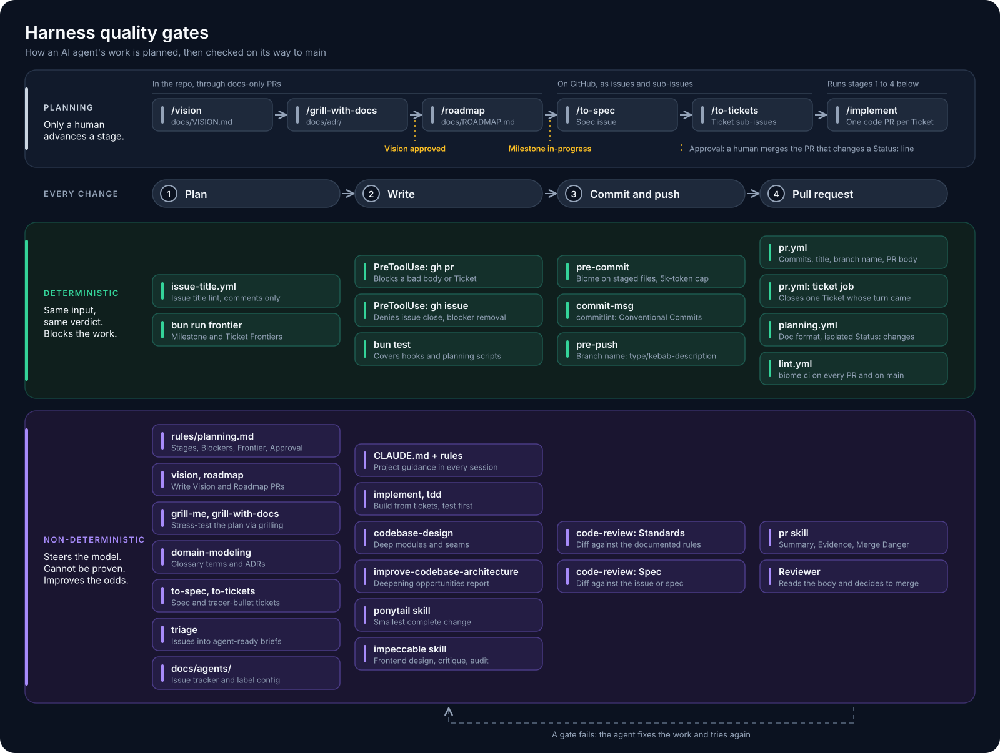

# Portfolio

A portfolio project built to work with AI coding agents. There is no application source yet: this repository is the **harness**, the tooling that keeps an agent's work correct and consistent from the first line of code.

## Install and run

Requires [Bun](https://bun.sh).

```sh
bun install      # installs dependencies and sets up the Husky git hooks
bun test         # runs the tests
bun run lint     # Biome: format, lint, import order
bun run fix      # applies Biome's safe fixes
```

There is no app to start yet. Once the source lands, its run command goes here.

## Workflow and quality gates

An agent is probabilistic, so the harness uses two kinds of checks:

- **Deterministic**: scripts, hooks and CI. The same input always gives the same verdict, and a failure blocks the work.
- **Non-deterministic**: instructions, skills and subagents that steer the model and give a reviewer something to judge. They improve the odds but prove nothing.



The diagram source is [`docs/workflow.excalidraw`](docs/workflow.excalidraw); open it at [excalidraw.com](https://excalidraw.com) to edit.

### Deterministic

| Where | Tool | Checks |
| --- | --- | --- |
| Agent runs `gh pr create` | `PreToolUse` hook (`.claude/hooks/check-pr-body.ts`) | PR body has `Summary`, `Evidence`, `Merge Danger`; no `--fill` |
| `git commit` | Husky `pre-commit` | Biome on staged files; no file over 5,000 tokens |
| `git commit` | Husky `commit-msg` + commitlint | Conventional Commits message |
| `git push` | Husky `pre-push` | Branch is `<type>/<kebab-description>` |
| Pull request | `pr.yml` | Every commit message, PR title, branch name, PR body |
| Pull request / `main` | `lint.yml` | `biome ci .` |
| Issue opened | `issue-title.yml` | Conventional Commits title (comments, does not block) |
| Any time | `bun test` | Tests, today the PR body check |

### Non-deterministic

| Tool | Where | Purpose |
| --- | --- | --- |
| `CLAUDE.md` | root | Project guidance loaded into every session |
| Rules | `.claude/rules/` | Comments, commits, branches/issues/PRs, language |
| `ponytail` skill | `.claude/skills/ponytail/` | Smallest complete change, no unrequested abstractions |
| `code-review` skill | `.claude/skills/code-review/` | Reviews a diff for Standards and Spec |
| `pr` skill | `.claude/skills/pr/` | Writes the PR body the hook then verifies |

The two kinds work together: a rule or skill tells the agent what good looks like, and a deterministic gate rejects the work when it still misses.

## Conventions

Commits, branches, issues and PR titles follow [Conventional Commits](https://www.conventionalcommits.org). Fix a rejected message or branch name instead of bypassing with `--no-verify`. Details are in [`CLAUDE.md`](CLAUDE.md) and `.claude/rules/`.
