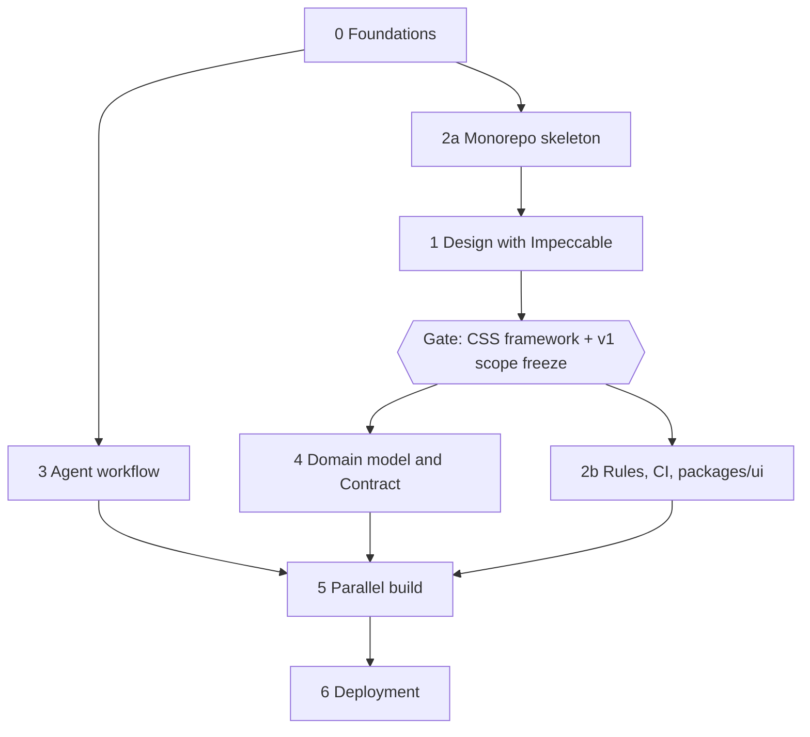

# Roadmap overview

This is a **pre-roadmap**: it fixes the process, the gates and the stack, and deliberately leaves the contents of v1 (pages, Content types, fields) to be derived from the approved design. Apart from Phase 0, nothing here is implemented yet. Vocabulary is in [`GLOSSARY.md`](../../GLOSSARY.md) and decisions in [`docs/adr/`](../adr/).

## Goals

1. Clean, defined and fast development.
2. TDD: every behavior is built red-green with the `tdd` skill, at pre-agreed seams.
3. Independent development: agents work in parallel and block each other only through declared ticket edges.
4. SDD: work starts from a spec (`to-spec`), is cut into tickets (`to-tickets`) and is built with `implement`.

## Context

A portfolio for a software engineer. A Bun monorepo with three apps: `api`, `portfolio` (public) and `cms` (Owner only). The Portfolio is dynamic: Content lives in the API's database. The Portfolio is bilingual (`en`, `pt-BR`), the CMS is English only. Everything is built and tested locally until the last phase.

## Phases

| Phase | File | Driver |
| --- | --- | --- |
| 0 Foundations | this file | Owner + one agent |
| 1 Design | [01-design-and-gate.md](01-design-and-gate.md) | Owner, interactive |
| 2 Monorepo and rules | [02-monorepo-and-rules.md](02-monorepo-and-rules.md) | agents |
| 3 Agent workflow | [03-agent-workflow.md](03-agent-workflow.md) | Owner + agent |
| 4 Domain and Contract | [04-domain-and-contract.md](04-domain-and-contract.md) | Owner, interactive |
| 5 Parallel build | [05-parallel-build.md](05-parallel-build.md) | many agents |
| 6 Deployment | [06-deployment.md](06-deployment.md) | undecided |

Deferred work lives in [backlog.md](backlog.md).

## Phase 0: foundations

Already in the repo: the harness (hooks, CI, commitlint, Biome), the `pr`, `code-review`, `ponytail`, `impeccable`, `grilling`, `grill-me`, `grill-with-docs`, `domain-modeling`, `codebase-design`, `to-spec`, `to-tickets`, `implement` and `tdd` skills, `GLOSSARY.md` and ADRs 0001-0005.

Remaining:

- Configure GitHub Issues as the tracker and create the triage labels (`ready-for-agent` at least). The skills point to `/setup-matt-pocock-skills` for this; it is not vendored, so either install it or write the label vocabulary down by hand.
- Merge these roadmap docs.

Exit criteria: labels exist, the roadmap is on `main`.

## Settled decisions

Independent of the design:

| Area | Decision |
| --- | --- |
| Runtime and language | TypeScript on Bun, Bun workspaces only (no Turborepo or Nx) |
| API | Fastify, Zod, OpenAPI (Swagger), Drizzle, PostgreSQL in Docker, Better Auth ([ADR 0003](../adr/0003-api-stack.md)) |
| Source of truth | The API owns Content and its invariants; the CMS is a custom client of it ([ADR 0001](../adr/0001-api-owns-content-and-invariants.md)) |
| Portfolio | Astro; i18next for hardcoded strings; locale-prefixed routes (`/en`, `/pt-br`), `/` redirects by `Accept-Language`, default `en` |
| CMS | Vite + React SPA, TanStack Router and Query, React Hook Form, Zod; English constants, no i18next |
| Shared UI | The Portfolio and the CMS import UI from `packages/ui`, as a plain rule ([ADR 0005](../adr/0005-shared-ui-package-before-css-framework.md)) |
| CSS framework | Not chosen. Decided at the gate after the design |
| Independence | Contract-first: `packages/contracts` is the seam between the apps ([ADR 0002](../adr/0002-contract-first-independent-apps.md)) |
| Publishing | Content is Published only when complete in both Locales ([ADR 0004](../adr/0004-publish-requires-both-locales.md)) |
| Access | Public endpoints return Published Content only; Owner endpoints need a session; no public sign-up, the Owner is seeded |
| Database in dev | One Docker Postgres; one database per worktree; a throwaway database per test run |
| Tests | API over HTTP (Fastify `inject`, real Postgres); apps at page level against Contract fixtures (MSW); a Playwright suite as a late integration ticket |
| Merging | Rebase and merge only, linear history; the Owner merges, agents never do |
| Agents | Manual-first Orca loop; Orca orchestration documented as an optional upgrade |
| Tracker | GitHub Issues with native blocking links |

## Provisional until Phase 4

These were discussed but depend on the design. Treat them as candidates, never as requirements:

- Which Content types exist in v1 and their fields (Profile, Experience, Skill and Media were floated; Project list and detail are v2).
- Long text as Markdown per Locale.
- One locale-independent slug, unique, editable only in Draft.
- Reusable Skills referenced by other Content, deletion blocked while referenced.
- Manual ordering versus date ordering.
- Media with alt text in every Locale, uploads behind a storage interface (local filesystem until deployment).

## How a phase file reads

Each phase file has: goal, depends on, work, outputs and exit criteria. A phase is done only when its exit criteria are all true.
